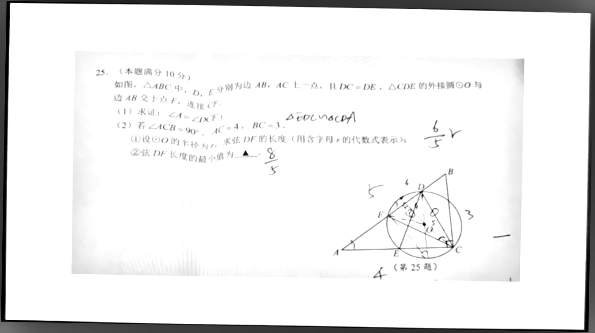

# 题目图片

- 原文件：q.jpg
- 处理模式：gray
- 质量：fast
- 笔迹处理：none
- 顺时针旋转：0°
- 方向置信度：99%
- 方向方法：document+textline-model
- 尺寸：1345 × 753
- 任务 ID：`20260817T075252_bb99376e`

## OCR 文本

未启用 OCR，或当前环境未安装 Tesseract。
